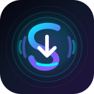

# SnapLoad (Android)

<p align="center">
  <a href="https://github.com/DarkSkyee/snapload-android/releases">
    
  </a>
  <a href="https://github.com/DarkSkyee/snapload-android/stargazers">
    
  </a>
  <a href="https://github.com/DarkSkyee/snapload-android/releases/latest">
    
  </a>
  <a href="LICENSE">
    
  </a>
</p>

<p align="center">
  
  
  
  
  <a href="https://github.com/yt-dlp/yt-dlp">
    
  </a>
</p>

<br/>

<p align="center">
  
</p>

<p align="center">
  <a href="https://github.com/DarkSkyee/snapload-android/releases/latest">
    
  </a>
</p>

> [!IMPORTANT]
> ### 🛡️ Google Play Protect Disclaimer
>
> When installing the downloaded APK, Android and **Google Play Protect may (and likely will) display a warning** indicating that the app comes from an unknown source outside the Google Play Store.  
> **This does NOT mean the app contains harmful or malicious code!** This is purely Android's standard automated security mechanism triggered for any directly installed application (*sideloaded APK*).  
> **SnapLoad is 100% open-source** — all media processing and downloads execute entirely on-device, with zero telemetry or remote tracking servers.  
> ➡️ **How to install:** In the warning prompt, tap **"More details"** and select **"Install anyway"**.

---

## 🌟 Highlights

**SnapLoad** is an ultra-fast, privacy-first multimedia downloader application engineered for Android. Unlike web-based converters or remote cloud services, **SnapLoad runs 100% on-device** using local Python/yt-dlp binaries and an on-demand FFmpeg multimedia engine.

Your links, files, and queries never leave your device. Downloaded media is immediately indexed and saved straight to your Android **Movies** or **Music** galleries via Scoped MediaStore integration.

---

## ✨ Features (v3.0+)

- 🪶 **Ultra-Lightweight (~21 MB base APK)**:
  - Base APK shrunk by **>60%** (from ~56 MB down to **~21 MB**), packaging lightning-fast execution binaries and modular on-demand engine loading.
- 🎧 **Spotify & YouTube Music Support**:
  - Full native support for Spotify tracks, albums, and playlists as well as YouTube Music.
  - Automatically fetches metadata and matches high-fidelity audio streams.
- 🎬 **Multi-Format Selection**:
  - **Video**: MP4 (H.264), MKV, WebM in Best Available, 1080p, 720p, 480p, or 360p.
  - **Audio**: MP3 (320kbps CBR / VBR Best), M4A, FLAC (Lossless), WAV, OPUS.
  - Automatic intelligent fallback: If a requested video stream is unavailable, SnapLoad seamlessly converts the highest quality audio track to MP3.
- 📋 **Batch Playlist Extraction**:
  - Fast, flat extraction of complete YouTube and Spotify playlists.
  - Select all, unselect all, or cherry-pick specific tracks to download sequentially.
- 📲 **System Share Sheet Integration (`ACTION_SEND`)**:
  - Share links directly from YouTube, TikTok, Spotify, Instagram, Reddit, X (Twitter), Facebook, Twitch, and 1000+ supported sites into SnapLoad.
- 🌐 **True Bi-Directional Localization**:
  - Full runtime language switching between **English (EN)** and **Polski (PL)** without restarting the app.
- 🔄 **In-App Dual Auto-Update Engine**:
  - Independent background updates for the **yt-dlp core extractor** directly from GitHub nightly releases.
  - Direct in-app GitHub releases checker and one-tap APK updater for SnapLoad itself.

---

## 📲 How to Install

1. Navigate to the **[Latest Releases](https://github.com/DarkSkyee/snapload-android/releases/latest)** page (or click the download button above).
2. Download the latest `SnapLoad-v*.apk` package.
3. Open the downloaded APK on your Android phone.
4. If prompted, allow **"Install unknown apps"** for your browser or file manager.
5. If Google Play Protect shows a prompt, tap **"More details"** ➔ **"Install anyway"**.
6. Enjoy completely free, local multimedia downloading!

---

## 🏗️ Architecture & Tech Stack

- **UI Framework**: Modern declarative UI with **Jetpack Compose** & **Material 3 Expressive**.
- **State Management**: Unidirectional Data Flow (UDF) powered by Kotlin `StateFlow` and Android Architecture ViewModels.
- **Concurrency**: Kotlin Coroutines with structured concurrency (`Dispatchers.IO` background execution).
- **Core Engine**: Embedded Python runtime (`youtubedl-android`) + FFmpeg binary distribution.
- **Storage Layer**: Modern scoped storage using Android `MediaStore` ContentResolver APIs (Android 10+ compliant, no legacy storage permissions needed).
- **Network & Parsing**: On-device link parsing, Spotify open graph scrapers, and GitHub REST API integration.

---

## 🛠️ Building From Source

```bash
# Clone the repository
git clone https://github.com/DarkSkyee/snapload-android.git
cd snapload-android

# Build signed release APK
./gradlew assembleRelease

# The resulting APK will be located at:
# app/build/outputs/apk/release/app-release.apk
```

---

## 📄 License

This project is licensed under the **MIT Non-Commercial License (MIT-NC) with Attribution**:
- ✅ **Allowed**: You are completely free to use, copy, modify, fork, and share this application for personal and educational purposes.
- ❌ **Commercial Prohibition**: You **may NOT** sell, resell, or monetize this software, its source code, or any derivative works in any way.
- ❌ **Attribution Required**: You **may NOT** remove the original author's name or claim authorship. All copies and forks must prominently retain attribution to the original creator, **DarkSkyee**.

See the full [LICENSE](LICENSE) file for complete legal terms.
